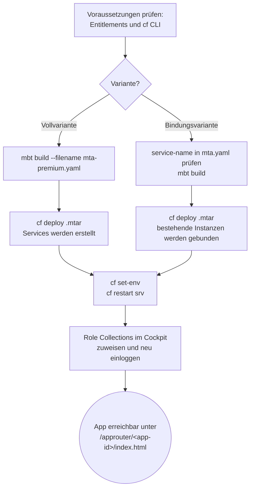

## Voraussetzungen

- Cloud Foundry Space in einer BTP-Subaccount mit zugewiesenen **Entitlements**:
  - `postgresql-db` (Plan standard, premium oder free)
  - `objectstore` (Plan s3-standard bzw. cloud-specific)
  - `xsuaa` (Plan application), `destination` (lite), `html5-apps-repo` (app-host + app-runtime)
- Lokale Tools: Node ≥ 20, `cf` CLI v8+ mit MultiApps-Plugin (`cf plugins`), `mbt` (MTA Build Tool), `@sap/cds-dk`, UI5 CLI
- Ein CAP-Projekt mit den üblichen Verzeichnissen: `db/` (Schema + CSV-Initialdaten), `srv/` (Backend), `app/<ui>/` (UI5-Frontend) und `gen/` als Build-Artefakt (entsteht beim `cds build`/`mbt build`)
- Eine bestehende, authentifizierte cf-CLI-Sitzung (`cf login`) — der Deployment-Prozess meldet sich nicht selbst an
- Die Entitlements müssen vor dem ersten Deployment zugewiesen sein — sonst scheitert die Service-Erstellung im Deployer.

## Typische MTA-Struktur

Unabhängig von der Variante besteht die MTA aus denselben Modulen:

| Modul | Zweck |
|---|---|
| `<mta-id>-srv` | CAP-Backend aus `gen/srv` (Node.js), gebunden an xsuaa, PostgreSQL, Object Store |
| `<mta-id>-postgres-deployer` | Einmaliger Task: wendet Schema und `db/data`-CSVs auf die PostgreSQL-Instanz an |
| `<mta-id>-ui` | `ui5 build preload` + Zip-Paketierung des Frontends |
| `<mta-id>-app-deployer` | `com.sap.application.content`: lädt das UI-Zip in die HTML5 Application Repository und registriert die dynamische srv-Destination |
| Approuter | Einziger benutzerseitiger Einstieg: OData-Routen → srv (Token-Weiterleitung), alles andere → HTML5 App Runtime |
| `<mta-id>-destinations` | Content-Broker-Einträge für die Content-Provider-Integration (z. B. SAP Build Work Zone) |

## Die zwei MTA-Varianten

Das Projekt enthält zwei alternative MTA-Deskriptoren mit identischen Modulen, aber unterschiedlicher Service-Strategie:

| | `mta.yaml` (minimal, Bindungsvariante) | `mta-premium.yaml` (Vollvariante) |
|---|---|---|
| MTA-ID | `<mta-id>-min` | `<mta-id>` |
| PostgreSQL | bindet die bestehende Instanz (Ressourcentyp `org.cloudfoundry.existing-service`, `service-name`) | erstellt `postgresql-db` aus `.deploy/pg-options.json` |
| Object Store | bindet die bestehende Instanz | erstellt `objectstore` aus `.deploy/objectstore-options.json` |

Wichtig: Beide Varianten dürfen nie gleichzeitig in verschiedenen Spaces derselben Subaccount laufen — der `xsappname` der xsuaa-Instanz wird pro Space gebildet und ist pro Subaccount eindeutig. Beim Wechsel der Variante in einem Space vorher `cf undeploy` der alten MTA ausführen.

## Schrittweise Konfiguration

### Schritt 1: Deployment-Artefakte anlegen

Alle deploy-spezifischen Dateien liegen gesammelt unter `.deploy/`; die MTA-Ressourcen referenzieren sie über `path`-Einträge, und `mbt` verpackt sie mit ins `.mtar`:

| Datei | Zweck |
|---|---|
| `mta.yaml` | Bindungsvariante: Module + `existing-service`-Ressourcen |
| `mta-premium.yaml` | Vollvariante: erstellt alle Service-Instanzen selbst |
| `.deploy/app-router/xs-app.json` | Routing des Approuters: `/odata/*` (und ggf. WebSocket-Routen) → srv-Destination mit Token-Weiterleitung (`ForwardAuthToken`), alles andere → `html5-apps-repo-rt` |
| `.deploy/app-router/package.json` | Approuter-Runtime (`@sap/approuter`) |
| `.deploy/xs-security.json` | Rollenmodell: Rollen-Templates, Scopes, Rollenkollektionen |
| `.deploy/pg-options.json` | Instanzparameter PostgreSQL (Speicher, Storage, Engine-Version, Wartungsfenster) |
| `.deploy/objectstore-options.json` | Object-Store-Parameter (z. B. Versioning, Ablauf nicht aktueller Versionen) |

### Schritt 2: Vollvariante bauen und deployen (inkl. Datenbank)

Die Vollvariante erstellt alle Services selbst und initialisiert die Datenbank über das `postgres-deployer`-Modul (Schema + CSVs als einmaliger Task):

```sh
cf target -s <space>
npx mbt build --filename mta-premium.yaml
cf deploy mta_archives/<mta-id>_1.0.0.mtar
```

### Schritt 3: Bindungsvariante (bestehende Instanzen)

In der Bindungsvariante werden die bestehenden Instanzen per `service-name` gebunden — die Namen in `mta.yaml` an die eigene Landschaft anpassen:

```sh
cf target -s <space>
npx mbt build
cf deploy mta_archives/<mta-id>-min_1.0.0.mtar
```

Diese Schritte lassen sich automatisieren: Ein Projekt-CLI kann den Deskriptor aus `mta.yaml` generieren, die Instanznamen und nicht-geheimen Umgebungsvariablen interaktiv abfragen (das generierte File ist gitignored und wird bei jedem Lauf neu erzeugt) und dann genau diese Befehlsfolge ausführen — `cf target -s`, `mbt build --filename <deskriptor>`, `cf deploy <mtar>`, danach `cf set-env` + `cf restart` für Geheimnisse. Ein `--dry-run` erzeugt und druckt die Befehle, ohne etwas auszuführen.

### Schritt 4: Secrets und Rollen

1. **Geheimnisse** (API-Keys, Passwörter) gehören nie ins MTA oder ins Artefakt — nach dem Deployment setzen und das Backend neu starten:
   ```sh
   cf set-env <mta-id>-srv <SECRET_ENV> <wert>
   cf restart <mta-id>-srv
   ```
2. **Rollen vergeben** im BTP Cockpit: Subaccount → Security → Role Collections → eigene Kollektion (z. B. `<app>-admin` / `<app>-user`) → eigenen Benutzer mit dem Standard-IDP hinzufügen. Danach neu einloggen — das alte JWT enthält die neuen Scopes nicht.

## Beispiele

Vollständiger Ablauf beider Varianten:

```sh
# Vollvariante (Services werden erstellt)
npx mbt build --filename mta-premium.yaml
cf deploy mta_archives/<mta-id>_1.0.0.mtar

# Bindungsvariante (bestehende Instanzen werden gebunden)
npx mbt build
cf deploy mta_archives/<mta-id>-min_1.0.0.mtar

# Secret und Neustart (beide Varianten)
cf set-env <mta-id>-srv <SECRET_ENV> <wert>
cf restart <mta-id>-srv
```

Auszug typischer PostgreSQL-Instanzparameter (`.deploy/pg-options.json`):

```jsonc
{
  "engine_version": "16",
  "memory": 4,
  "storage": 20,
  "multi_az": true,
  "cross_region_backup": true,
  "maintenance_window": { "day_of_week": "Sunday", "duration": 1, "start_hour_utc": 4 },
  "region": "<hyperscaler-region>"
}
```

Zugriff auf das Frontend nach dem Deployment (der Approuter löst die App über den App-ID-Pfad auf, nicht über `/index.html`):

```
https://<approuter-route>/<app-id-ohne-sonderzeichen>/index.html
```

## Stolpersteine

Typische Fallstricke bei diesem Setup:

1. **`xsappname`-Regeln des XSUAA-Brokers**: maximal 100 Zeichen, keine Punkte — nur Buchstaben, Ziffern, `_`, `-`, `/`. Der `xsappname` wird pro Space gebildet und ist pro Subaccount eindeutig; eine Subaccount kann dieselbe App nicht in zwei Spaces gleichzeitig tragen.
2. **`role-template-references` müssen Strings mit `$XSAPPNAME`-Präfix sein**: `["$XSAPPNAME.admin"]` — nackte Namen (`["admin"]`) und Objekt-Formen (`[{ "name": "admin" }]`) werden vom Broker abgelehnt.
3. **Geister-Instanz nach fehlgeschlagenem Deploy**: bleibt eine xsuaa-Instanz im Zustand `create failed` hängen, schlagen Updates mit 404 fehl — Recovery über `cf delete-service <instance> -f`, dann neu deployen.
4. **Plan-Sizing PostgreSQL**: der `standard`-Plan erlaubt nur 2 oder 4 GB Arbeitsspeicher — 8 GB und mehr sind `premium`-Größen und werden vom Broker abgelehnt. Vor dem Deploy prüfen, dass `memory` zum gewählten Plan passt; Storage ist nach der Erstellung nicht mehr änderbar.
5. **Free-Plan** ohne Konfigurationskörper erstellen (keine Größenparameter); 120-Tage-Lebenszyklus (danach kann SAP die Instanz löschen), Downgrade standard → free nicht möglich, Upgrade jederzeit ohne Datenverlust.
6. **postgres-deployer insertet die CSVs bei jedem Lauf** — bei bereits initialisierter Datenbank das Modul aus der MTA entfernen, sonst entstehen Duplikate.
7. **`mbt build` führt `npm ci` im Projektroot aus** und ersetzt `node_modules` — danach `npm install` nachziehen, wenn lokale Dev-Tools fehlen.
8. **Schema-Deltas**: der Deployer berechnet Deltas gegen die gespeicherte Modell-Baseline und verweigert destruktive Änderungen (`Dropping tables is not supported`) — bei inkompatiblem Alt-Schema die Tabellen per CF-Task droppen (die Instanz ist privat, `public_access: false`) und dann sauber voll deployen.
9. **App-URL des Approuters**: HTML5-Apps liegen unter dem App-ID-Pfad (App-ID aus `webapp/manifest.json`, Sonderzeichen entfernt) — ein 503 auf `/index.html` heißt falscher Pfad, nicht defektes Deployment. Die Backend-Route antwortet auf `GET /` mit "Cannot GET /" — das ist normal, das OData-API liegt unter `/odata/v4/<service>`.
10. **Laufende Deploys stoppen alle Apps** — während des Deploy-Fensters sind 503/Fehler zu erwarten; Status prüfen mit `cf mta-ops` bzw. `cf apps`.

## Prozess



## Beispielkonfigurationen

Generisches Beispiel für `com.example.cap.myapp` (CAP-Backend `srv/`, UI5-Frontend `app/myapp-ui`, PostgreSQL, Object Store) — Namens- und Pfadplatzhalter an das eigene Projekt anpassen. Die Formate entsprechen der MTA-Spezifikation 3.3.

### `mta-premium.yaml` — Vollvariante (Services werden erstellt)
Siehe [[Cap App Object Store - MTA Premium]]
### Ressourcen der Bindungsvariante (`mta.yaml`)

In der Bindungsvariante sind nur die beiden Ressourcen anders — Module, approuter, HTML5 und Destination bleiben identisch:

```yaml
resources:
  # EXISTING PostgreSQL instance — bound, not created
  - name: com.example.cap.myapp-postgres
    type: org.cloudfoundry.existing-service
    parameters:
      service-name: myapp-postgres-sql

  # EXISTING Object Store instance — bound, not created
  - name: com.example.cap.myapp-objectstore
    type: org.cloudfoundry.existing-service
    parameters:
      service-name: myapp-object-store
```

### `.deploy/xs-security.json` — Rollenmodell

```json
{
  "scopes": [
    {
      "name": "$XSAPPNAME.admin",
      "description": "Administrator access (all entities and actions)"
    },
    {
      "name": "$XSAPPNAME.user",
      "description": "Business user access"
    }
  ],
  "attributes": [],
  "role-templates": [
    {
      "name": "admin",
      "description": "Full access to all entities and actions",
      "scope-references": [
        "$XSAPPNAME.admin"
      ]
    },
    {
      "name": "user",
      "description": "Read/write access for business users",
      "scope-references": [
        "$XSAPPNAME.user"
      ]
    }
  ],
  "role-collections": [
    {
      "name": "myapp-admin",
      "description": "Administrators of the application",
      "role-template-references": [
        "$XSAPPNAME.admin"
      ]
    },
    {
      "name": "myapp-user",
      "description": "Business users of the application",
      "role-template-references": [
        "$XSAPPNAME.user"
      ]
    }
  ]
}
```

Nutzt die App einen Job Scheduler, zusätzlich einen Scope `"name": "$XSAPPNAME.jobscheduler"` mit `"grant-as-authority-to-apps": ["$XSSERVICENAME(<mta-id>-jobscheduler)"]` und ein gleichnamiges Rollen-Template aufnehmen (der Platzhalter muss exakt dem Ressourcennamen im MTA entsprechen).

### `.deploy/pg-options.json` — PostgreSQL-Instanzparameter

```json
{
  "allow_access": "",
  "audit_log_level": [
    "DDL",
    "ROLE"
  ],
  "backup_retention_period": 14,
  "cross_region_backup": true,
  "db_parameters": [],
  "engine_version": "16",
  "ignore_default_ips": false,
  "locale": "en_US",
  "maintenance_window": {
    "day_of_week": "Sunday",
    "duration": 1,
    "start_hour_utc": 4
  },
  "memory": 4,
  "multi_az": true,
  "public_access": false,
  "region": "eu-central-1",
  "storage": 20
}
```

### `.deploy/objectstore-options.json` — Object-Store-Parameter

```json
{
  "autoExpiration": [
    {
      "id": "ExpireNonCurrentVersions",
      "status": "Enabled",
      "expirationInDays": 0,
      "expiredObjectDeleteMarker": false,
      "noncurrentVersionExpiration": {
        "days": 14,
        "newerNoncurrentVersions": -1
      },
      "filter": {}
    }
  ],
  "backupEnabled": false,
  "backupRetentionPeriod": 0,
  "enableSAL": false,
  "preventDeletion": false,
  "salLogsRetentionPeriod": 0,
  "usesCustomEncryption": false,
  "versioning": true
}
```

### `.deploy/app-router/xs-app.json` — Routing

```json
{
  "welcomeFile": "/index.html",
  "authenticationMethod": "route",
  "routes": [
    {
      "source": "^/odata/v4/(.*)$",
      "target": "/odata/v4/$1",
      "destination": "srv-api",
      "authenticationType": "xsuaa",
      "csrfProtection": true
    },
    {
      "source": "^(.*)$",
      "service": "html5-apps-repo-rt",
      "authenticationType": "xsuaa",
      "target": "$1"
    }
  ]
}
```

### `.deploy/app-router/package.json` — Approuter-Runtime

```json
{
  "name": "approuter",
  "dependencies": {
    "@sap/approuter": "^22.0.0"
  },
  "scripts": {
    "start": "node node_modules/@sap/approuter/approuter.js"
  }
}
```

## Referenzen

- **CAP — Deployment auf Cloud Foundry**: https://cap.cloud.sap/docs/guides/deploy/to-cf
- **SAP Cloud MTA Build Tool (mbt)**: https://sap.github.io/cloud-mta-build-tool/
- **Cloud Foundry CLI**: https://cli.cloudfoundry.org/
- **Application Security Descriptor (xs-security.json, Syntax)**: https://help.sap.com/docs/btp/sap-business-technology-platform/application-security-descriptor-configuration
- **Rollenkollektionen und Rollen (Cloud Foundry)**: https://help.sap.com/docs/btp/sap-business-technology-platform/role-collections-and-roles-for-the-cloud-foundry-environment
- **HTML5 Application Repository**: https://help.sap.com/docs/btp/sap-business-technology-platform/html5-application-repository
- **PostgreSQL on SAP BTP (Dokumentation)**: https://help.sap.com/docs/postgresql-on-sap-btp — Pläne und Entitlements: https://help.sap.com/docs/postgresql-on-sap-btp/service-plans-and-entitlements
- **Object Store Service on SAP BTP**: https://help.sap.com/docs/object-store-service-on-sap-btp
- **SAP Application Router (@sap/approuter)**: https://www.npmjs.com/package/@sap/approuter
````